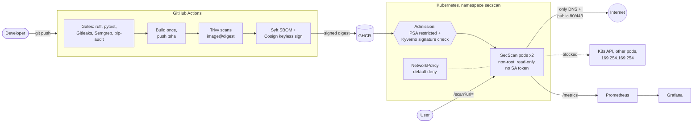
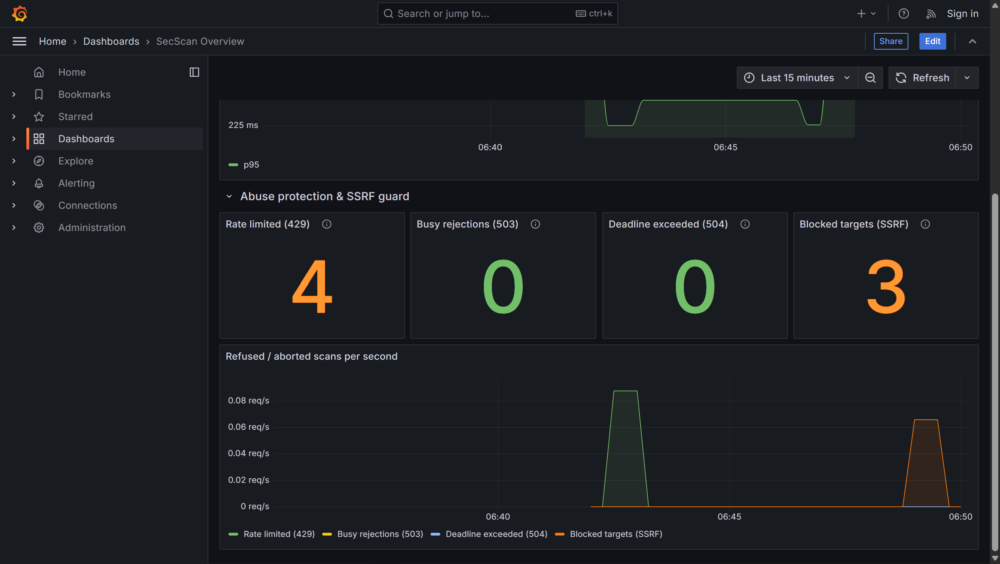

# SecScan

[](https://github.com/vladyslav-krutii/secscan/actions/workflows/ci.yml)
[-blueviolet)](docs/SUPPLY_CHAIN.md#verify-an-image-yourself)
[](docs/SUPPLY_CHAIN.md)

[](LICENSE)

**SecScan** is a small API that fetches a URL and grades its HTTP security
headers (HSTS, CSP, X-Frame-Options, …) from A to F. The app is the excuse;
the project is **securing it end to end the way a bank would expect**: I
found and fixed an SSRF in my own scanner, added abuse protection, built a
CI pipeline that scans, SBOMs and **keyless-signs** a single image digest,
and deployed it to Kubernetes where **only that signed digest is admitted**
and a default-deny NetworkPolicy blocks the cluster even if the app code
fails. Every control has a test, a CI gate or a verify script as evidence.

## What this demonstrates

| Area | What I built | Evidence |
|---|---|---|
| **AppSec** | SSRF guard (resolve-then-allowlist, connection pinned to the validated IP, every redirect re-validated); rate limit, concurrency cap, scan deadline; `X-Forwarded-For` trusted only from configured proxies; value-based header grading | [SSRF write-up](docs/SSRF.md) with before/after, 189 tests (`tests/test_ssrf.py`, `test_abuse.py`, `test_rules.py`) |
| **CI/CD supply chain** | Gitleaks, Semgrep, pip-audit, Trivy (SARIF); actions pinned by SHA, images by digest, least-privilege tokens; **build once** → scan → Syft SBOM → Cosign keyless sign + attest the **same digest** → verify → move `:latest` | [SUPPLY_CHAIN.md](docs/SUPPLY_CHAIN.md), [CI runs](https://github.com/vladyslav-krutii/secscan/actions/workflows/ci.yml) |
| **Kubernetes** | Kustomize, deploy by digest; PSA `restricted`; no SA token; non-root, read-only, drop ALL, seccomp; PDB, probes, limits; default-deny NetworkPolicy, egress only DNS + public 80/443 (**second SSRF layer**); Kyverno admits only images signed by this repo's CI on `main` | [KUBERNETES.md](docs/KUBERNETES.md), [`scripts/k8s-verify.sh`](scripts/k8s-verify.sh): 14/14 checks pass |
| **Observability** | Prometheus metrics for scans, latency and every refusal (429/503/504/SSRF); auto-provisioned Grafana dashboards; JSON logs | screenshots below |
| **Risk management** | STRIDE threat model with control → evidence; time-boxed accepted risks with expiry dates | [THREAT_MODEL.md](docs/THREAT_MODEL.md), [SECURITY.md](SECURITY.md#accepted-risks) |

## Architecture



Inside the app, a `/scan` request passes: rate limit (429) → free scan slot
(503) → SSRF guard on every hop (400) → overall deadline (504). Details:
[ABUSE_PROTECTION.md](docs/ABUSE_PROTECTION.md).

## Screenshots

**Web UI**: type a URL, get a graded report with per-header advice.


**Grafana**: total scans, error rate, scans by grade, p95 latency.


**Abuse protection & SSRF guard, live**: a 12-request burst gave four `429`s,
and three scans of `http://prometheus` were refused as SSRF (`400`).



## Quickstart

### Docker Compose (API + Prometheus + Grafana)

```bash
docker compose up --build -d
curl "http://localhost:8000/scan?url=https://github.com"
```

| Service | URL |
|---|---|
| SecScan UI / API docs | http://localhost:8000 · http://localhost:8000/docs |
| Prometheus | http://localhost:9090 |
| Grafana | http://localhost:3000 (anonymous, dashboard "SecScan Overview") |

Port 3000 taken? `GRAFANA_PORT=3001 docker compose up -d`
(PowerShell: `$env:GRAFANA_PORT=3001; docker compose up -d`).

### Kubernetes (kind + Calico + Kyverno)

```bash
kubectl apply -k k8s/policy          # namespace (PSA restricted) + signature policy first
kubectl apply -k k8s/overlays/kind   # the app, pinned to the signed digest
kubectl -n secscan rollout status deploy/secscan
bash scripts/k8s-verify.sh           # prove it: app, network, admission
```

Prerequisites and the full verify output: [KUBERNETES.md](docs/KUBERNETES.md).

### Local development

```bash
pip install -r requirements-dev.txt
pytest -q && ruff check .
uvicorn app.main:app --reload        # http://127.0.0.1:8000/docs
```

## API

| Method | Path | Description |
|---|---|---|
| GET | `/` | Web UI |
| GET | `/scan?url=` | Scan a URL, returns score, grade and per-header `points` / `issues` ([grading](docs/GRADING.md)) |
| GET | `/health` | Probes |
| GET | `/info` | Service metadata |
| GET | `/metrics` | Prometheus metrics |

Configuration (`SECSCAN_RATE_LIMIT`, `SECSCAN_TRUSTED_PROXIES`, …):
[ABUSE_PROTECTION.md](docs/ABUSE_PROTECTION.md#configuration).

## Documentation

| Document | For |
|---|---|
| [docs/THREAT_MODEL.md](docs/THREAT_MODEL.md) | STRIDE: threat → control → where → how it is verified; accepted risks |
| [docs/SSRF.md](docs/SSRF.md) | SSRF in my own scanner: reproduction, fix, before/after, tests |
| [docs/ABUSE_PROTECTION.md](docs/ABUSE_PROTECTION.md) | Rate limit, concurrency cap, deadline, `X-Forwarded-For` |
| [docs/GRADING.md](docs/GRADING.md) | How each header is graded by value |
| [docs/SUPPLY_CHAIN.md](docs/SUPPLY_CHAIN.md) | CI gates, build once, SBOM, Cosign, how to verify the image |
| [docs/KUBERNETES.md](docs/KUBERNETES.md) | PSA, Kyverno, NetworkPolicy, verify script output |
| [SECURITY.md](SECURITY.md) | Reporting, practices, accepted risks |
| [docs/INTERVIEW.md](docs/INTERVIEW.md) | Project story and Q&A (Ukrainian) |
| [docs/LEARNING.md](docs/LEARNING.md) | Study log for every commit (Ukrainian) |

## Project structure

```
secscan/
├── app/                  # FastAPI: scanner + SSRF guard, rules, abuse protection, metrics
├── tests/                # 189 pytest tests, network faked (tests/fakenet.py)
├── k8s/                  # Kustomize: namespace, base, overlays/kind, policy (Kyverno), components/ingress
├── scripts/k8s-verify.sh # proves the K8s hardening on a live cluster
├── monitoring/           # Prometheus + Grafana provisioning
├── docs/                 # deep dives, threat model, interview notes, screenshots
├── .github/workflows/    # CI: gates, build once, scan, SBOM, sign, verify
├── Dockerfile            # multi-stage, non-root, base pinned by digest
└── docker-compose.yml    # api + prometheus + grafana
```

## License

MIT, see [LICENSE](LICENSE).
