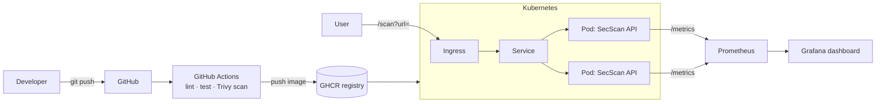

# SecScan

> A security-headers scanner API, wrapped in a **production-style DevOps pipeline** —
> containerization, CI/CD, Kubernetes, monitoring and logging.

[](https://github.com/vladyslav-krutii/secscan/actions/workflows/ci.yml)


The application is deliberately small — it fetches a URL, inspects its security
headers (HSTS, CSP, X-Frame-Options, …) and grades them **A–F**. The point of
this repository is everything *around* the app: how it is built, tested, scanned,
shipped, deployed and observed.

### What this project demonstrates

| DevOps area        | In this repo                                                     |
| ------------------ | ---------------------------------------------------------------- |
| **Containerization** | Multi-stage, non-root Docker image with a healthcheck           |
| **CI/CD**            | GitHub Actions: lint → test → build → Trivy scan → push to GHCR  |
| **Deployment**       | Kubernetes manifests (Deployment, Service, Ingress) + Compose   |
| **Monitoring**       | Prometheus scrapes `/metrics`; Grafana dashboard                |
| **Logging**          | Structured JSON logs to stdout (Loki/ELK ready)                 |
| **Security**         | Trivy image scanning, hardened runtime, Dependabot              |

---

## Screenshots

**Web UI** — type a URL, get a graded report with per-header advice:


**Grafana dashboard** — total scans, error rate, scans by grade, p95 latency:


---

## Architecture



## Tech stack

| Area                | Tooling                                             |
| ------------------- | --------------------------------------------------- |
| Application         | Python 3.12, FastAPI, Uvicorn, httpx                |
| Containerization    | Docker (multi-stage, non-root, healthcheck)         |
| Local orchestration | Docker Compose (api + Prometheus + Grafana)         |
| CI/CD               | GitHub Actions → Ruff, Pytest, Trivy, push to GHCR  |
| Deployment          | Kubernetes (Deployment, Service, Ingress)           |
| Monitoring          | Prometheus (`/metrics`) + Grafana                   |
| Logging             | Structured JSON logs to stdout                      |

---

## Quickstart

### 1. Run the full stack (Docker Compose)

```bash
docker compose up --build -d
```

| Service     | URL                                       |
| ----------- | ----------------------------------------- |
| SecScan API | http://localhost:8000/docs                |
| Prometheus  | http://localhost:9090                     |
| Grafana     | http://localhost:3000 (anonymous admin)   |

Generate some traffic, then watch it on the Grafana **SecScan Overview** dashboard:

```bash
make load        # or: curl "http://localhost:8000/scan?url=https://github.com"
```

### 2. Run locally (Python)

```bash
pip install -r requirements-dev.txt
make test        # ruff + pytest
make run         # uvicorn with autoreload → http://127.0.0.1:8000/docs
```

### 3. Deploy to Kubernetes

Spin up a local cluster with [kind](https://kind.sigs.k8s.io/) and deploy (verified: 2/2 pods, reachable via the Service):

```bash
kind create cluster --name secscan --config k8s/kind-config.yaml
kind load docker-image secscan:local --name secscan
kubectl apply -f k8s/deployment.yaml -f k8s/service.yaml
kubectl set image deployment/secscan api=secscan:local   # use the locally loaded image
kubectl rollout status deployment/secscan
kubectl port-forward svc/secscan 8088:80                 # curl http://localhost:8088/health
```

Against a real cluster the image comes from GHCR (`k8s/deployment.yaml`) and `k8s/ingress.yaml` exposes it.

---

## API

| Method | Path       | Description                                 |
| ------ | ---------- | ------------------------------------------- |
| GET    | `/`        | Web UI (scan form + graded report)          |
| GET    | `/info`    | Service metadata (JSON)                     |
| GET    | `/health`  | Liveness/readiness probe                    |
| GET    | `/scan`    | Scan a URL: `/scan?url=https://github.com`  |
| GET    | `/metrics` | Prometheus metrics                          |

```bash
curl "http://localhost:8000/scan?url=https://github.com"
```

```json
{
  "url": "https://github.com",
  "status_code": 200,
  "score": 90,
  "grade": "A",
  "headers": [
    { "name": "strict-transport-security", "present": true, "value": "max-age=31536000", "advice": null }
  ]
}
```

Example grades from a quick run:

| Site               | Grade | Score |
| ------------------ | ----- | ----- |
| cloudflare.com     | A     | 100   |
| github.com         | A     | 90    |
| example.com        | F     | 0     |

---

## CI/CD pipeline

On every push / pull request (`.github/workflows/ci.yml`):

1. **Lint** — `ruff check`
2. **Test** — `pytest`
3. **Build** — multi-stage Docker image (with layer caching)
4. **Scan** — Trivy reports HIGH/CRITICAL and fails the build on CRITICAL
5. **Push** — image published to **GHCR** as `latest` + commit SHA (on `main`)

## Monitoring & metrics

The API exports Prometheus metrics:

- `secscan_scans_total{grade="A"}` — scans by resulting grade
- `secscan_scan_duration_seconds` — scan latency histogram
- `secscan_scan_errors_total` — failed scans
- `secscan_blocked_targets_total` — scans refused by the SSRF guard
- `secscan_rate_limited_total` — requests refused with `429` (per-client rate limit)
- `secscan_busy_rejections_total` — requests refused with `503` (all scan slots in use)
- `secscan_scan_deadline_exceeded_total` — scans aborted with `504` (overall deadline)

Prometheus scrapes them and the Grafana dashboard (auto-provisioned) shows total
scans, error rate, scans/sec by grade and p95 latency.

## Security hardening

- Runs as a **non-root** user (uid 10001), no shell
- `readOnlyRootFilesystem`, `allowPrivilegeEscalation: false`, all capabilities dropped
- Minimal `python:3.12-slim` base, multi-stage build (no build tools in final image)
- Trivy image-scanning gate in CI + weekly Dependabot updates
- SSRF guard on the scan target (see the write-up below)
- Per-client rate limit, concurrency cap and an overall scan deadline
  (see "Abuse protection" below)

## Security write-up: SSRF in `/scan`

### The vulnerability

`/scan` fetches a URL chosen by the caller. The first version only checked the
scheme, then called `httpx` with `follow_redirects=True`. Anyone who could reach
the API could therefore make the server send requests **from inside its own
network** and read back the status code and headers: a server-side request
forgery (SSRF) that works as an internal network mapper.

Reproduced against the docker compose stack before the fix; all four requests
returned `200` (raw responses in [`docs/ssrf-before.txt`](docs/ssrf-before.txt)):

| Request through `/scan`           | What it reached                          |
| --------------------------------- | ---------------------------------------- |
| `http://prometheus:9090`          | Prometheus, by its compose service name  |
| `http://grafana:3000/login`       | Grafana login page                       |
| `http://127.0.0.1:8000/health`    | the API itself over loopback             |
| `http://api:8000/metrics`         | the API's own metrics endpoint           |

In Kubernetes the same request shape reaches `kubernetes.default.svc`, other
pods and the cloud metadata endpoint `169.254.169.254`.

### The fix (`app/scanner.py`)

Every URL, the original one and each redirect target, goes through the same checks:

1. **Scheme and port**: only `http`/`https` on ports 80 and 443. URLs with
   embedded credentials are refused.
2. **Resolve, then allowlist**: the hostname is resolved with the OS resolver
   and every returned address must be globally routable
   (`ipaddress.is_global`, not multicast). This is an allowlist, not a
   blocklist, so loopback, RFC 1918, link-local, CGNAT `100.64.0.0/10`,
   IPv6 unique-local/link-local and reserved ranges are rejected without a
   list to maintain. IPv4-mapped IPv6 is unwrapped first; NAT64 and 6to4
   prefixes are refused. If a name has several records and one is internal,
   the whole request is refused.
3. **Connect to the validated IP**: the request is sent to the address that was
   just checked, with the original name in the `Host` header and in TLS SNI, so
   the certificate is still verified against the hostname. The name is never
   resolved a second time, which closes the DNS-rebinding window between
   "check" and "connect".
4. **Manual redirects**: `follow_redirects=False`; each `Location` is validated
   as in steps 1 to 3, with at most 5 redirects.
5. **Headers only**: the response is opened as a stream and the body is never
   read, so a huge or endless body cannot tie up the service.
6. **No ambient proxy**: `trust_env=False`, so `HTTP_PROXY`-style variables
   cannot reroute the request around the pinned address.

A refused target returns `400` with a generic `Blocked target: ...` message,
increments `secscan_blocked_targets_total` and is logged with the reason. The
resolved internal address is written to the log only, not returned to the caller.

### Before / after

The same requests against the docker compose stack, run from the Linux
container image (raw output: [`docs/ssrf-before.txt`](docs/ssrf-before.txt),
[`docs/ssrf-after.txt`](docs/ssrf-after.txt)):

| Request through `/scan`                                   | Before | After                                      |
| --------------------------------------------------------- | ------ | ------------------------------------------ |
| `http://prometheus:9090`                                  | `200`  | `400` port is not allowed                  |
| `http://grafana:3000/login`                               | `200`  | `400` port is not allowed                  |
| `http://127.0.0.1:8000/health`                            | `200`  | `400` port is not allowed                  |
| `http://api:8000/metrics`                                 | `200`  | `400` port is not allowed                  |
| `http://prometheus` (port 80, resolves to `172.18.0.3`)   | n/a    | `400` not a public internet address        |
| `http://169.254.169.254`                                  | n/a    | `400` not a public internet address        |
| `http://2130706433` (glibc resolves it to `127.0.0.1`)    | n/a    | `400` not a public internet address        |
| public redirector → `http://127.0.0.1/`                   | n/a    | `400` redirect target is not a public address |
| public redirector → `http://169.254.169.254/...`          | n/a    | `400` redirect target is not a public address |
| public redirector → `https://github.com/`                 | n/a    | `200`, grade A (public redirects still work) |
| `https://github.com`                                      | grade A | `200`, grade A                            |

"n/a" rows were not captured before the fix. The redirect rows use
`https://postman-echo.com/redirect-to?url=...`, which answers with a real `302`;
the API log shows one outbound request to the redirector and no second hop.

### The tests (`tests/test_ssrf.py`)

Written before the fix and confirmed failing (38 failures), then made to pass.
DNS and HTTP are both faked, so the suite is deterministic and also asserts
that **no request left the process** for a blocked target. Covered: loopback,
`0.0.0.0`, metadata address, private and CGNAT ranges, IPv6 (`::1`,
IPv4-mapped, unique-local, link-local), decimal/hex/octal IPv4 forms, compose
and Kubernetes service names, DNS records pointing at private space, non-web
ports, redirects from a public host to each kind of internal target, the
redirect cap, connection pinning, a rebinding resolver, and the unread body.

### Known limits

- The error message still distinguishes "blocked" from "could not resolve", so
  a caller can learn whether an internal DNS name exists. Accepted for now in
  exchange for useful errors.
- Only the first resolved address is used; there is no fallback to other
  records if it is unreachable.
- This is one layer. A Kubernetes `NetworkPolicy` that denies egress to
  cluster and metadata ranges is planned as a second, independent layer.

## Abuse protection

`/scan` makes the server do network work on behalf of an anonymous caller, so
it is the endpoint worth protecting. `/health` and `/metrics` are not limited:
probes and Prometheus call them far more often than any scan limit allows.

A request to `/scan` passes the gates in this order, cheapest first, and a
request refused by one gate never reaches the next:

| # | Gate                 | Refusal                     | Why                                                   |
| - | -------------------- | --------------------------- | ----------------------------------------------------- |
| 1 | Per-client rate limit | `429` + `Retry-After`      | one client cannot use the scanner as a traffic source |
| 2 | Free scan slot       | `503` + `Retry-After`       | bounded number of outbound scans per process          |
| 3 | SSRF validation      | `400 Blocked target: ...`   | see the write-up above                                |
| 4 | Overall deadline     | `504`                       | a slow target cannot hold a slot indefinitely         |

- **Rate limit** ([slowapi](https://github.com/laurentS/slowapi), moving
  window). Every request counts, including the ones the SSRF guard refuses:
  probing internal names is exactly the traffic to slow down.
- **Concurrency cap**. When all slots are taken the request is refused at once
  instead of queued. A queue would keep connections open and let a client stack
  up work for later.
- **Deadline**. One clock covers every DNS lookup and redirect hop of a scan.
  Before, only per-hop timeouts existed, so a slow redirect chain could run for
  about 6 hops x (5 s DNS + 5 s HTTP). When the deadline fires the task is
  cancelled, the open response stream and the HTTP client are closed, and the
  slot is released.

### Who is "the client"? (`X-Forwarded-For`)

The rate limit is keyed on the client address, and that address must be one the
client cannot choose.

- By default the address of the **TCP peer** is used and `X-Forwarded-For` is
  ignored. Otherwise a client could send a different header value with every
  request and never be limited.
- Behind a reverse proxy (the Ingress) every request arrives from the proxy, so
  all clients would share a single bucket. `SECSCAN_TRUSTED_PROXIES` lists the
  proxy addresses; only when the peer is in that list is `X-Forwarded-For` read.
- The header is walked **right to left** and the first address that is not a
  trusted proxy is the client. A proxy appends the peer it saw, so only the
  right-hand entries were written by our own infrastructure; everything further
  left was supplied by the client and is ignored.

### Configuration

Read once at start-up. An unparsable value stops the process instead of
silently falling back to a default.

| Variable                        | Default     | Meaning                                                        |
| ------------------------------- | ----------- | -------------------------------------------------------------- |
| `SECSCAN_RATE_LIMIT`            | `10/minute` | Scans per client address (`limits` notation, e.g. `100/hour`)  |
| `SECSCAN_TRUSTED_PROXIES`       | *(empty)*   | Comma-separated IPs/CIDRs whose `X-Forwarded-For` is believed  |
| `SECSCAN_SCAN_DEADLINE_SECONDS` | `10`        | Wall-clock budget for one scan, all hops and DNS included      |
| `SECSCAN_MAX_CONCURRENT_SCANS`  | `10`        | Outbound scans running at once, per process                    |

### Known limits

- **Counters live in process memory.** With N replicas each pod counts on its
  own, so the effective limit is about N x `SECSCAN_RATE_LIMIT`, and a restart
  resets it. The fix is a shared store (Redis, which slowapi supports through
  `storage_uri`); left out to keep the deployment dependency-free.
- **`X-Forwarded-For` is only as trustworthy as `SECSCAN_TRUSTED_PROXIES`.**
  Anything inside the listed ranges can claim any client address.
  `k8s/deployment.yaml` currently sets it to the whole pod CIDR
  (`10.244.0.0/16`), which trusts **every pod in the cluster**, not just the
  Ingress. To be narrowed in Phase 5: trust the ingress controller only, and
  add a `NetworkPolicy` so that nothing else can reach the API at all.
- The limit is per address: clients behind one NAT share a bucket, and an IPv6
  user with a whole `/64` has many addresses.
- A cancelled DNS lookup cannot be interrupted: `getaddrinfo` keeps its worker
  thread until the OS resolver gives up. The concurrency cap bounds how many
  can pile up.
- The concurrency cap is per process, like the rate limit.

---

## Project structure

```
secscan/
├── app/                  # FastAPI application
│   ├── main.py           # routes, logging, metrics, response models
│   ├── scanner.py        # header fetch + scoring, SSRF guard, deadline
│   ├── abuse.py          # client identity, rate limiter, scan slots
│   ├── config.py         # settings from environment variables
│   └── metrics.py        # Prometheus metrics
├── tests/                # pytest unit/API tests
├── monitoring/           # Prometheus + Grafana provisioning
├── k8s/                  # Kubernetes manifests
├── .github/workflows/    # CI/CD pipeline
├── Dockerfile            # multi-stage, non-root
├── docker-compose.yml    # api + prometheus + grafana
└── Makefile              # common tasks (make help)
```

## License

MIT — see [LICENSE](LICENSE).
