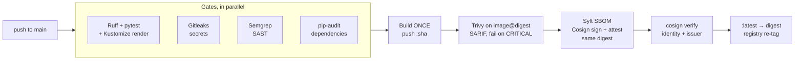

# Supply chain: from commit to signed image

Phase 4 (and the build-once fix in Phase 5). Everything runs in
[`.github/workflows/ci.yml`](../.github/workflows/ci.yml) on every push and
pull request; nothing is pushed or signed for pull requests.



| Job | What it does | Fails the build when |
|---|---|---|
| `test` | `ruff check`, `pytest` (188 tests), renders `k8s/policy` and `k8s/overlays/kind`, checks the image is pinned `@sha256:` | lint/test error, broken overlay, image by tag |
| `secrets` | Gitleaks over the **whole history** | any secret found |
| `sast` | Semgrep `p/python`, `p/dockerfile`, `p/github-actions` | any finding |
| `deps` | pip-audit over the resolved tree of `requirements*.txt` (incl. transitive) | any known vulnerability, or a package it cannot check (`--strict`) |
| `build-scan-push` | builds once; on `main` pushes only `:<sha>`; Trivy scans that **digest** from GHCR (SARIF → Security tab) | CRITICAL with a fix available |
| `sbom-sign` | Syft SPDX SBOM (build artifact), Cosign keyless signature and SBOM attestation on the **same digest**, `cosign verify` + `verify-attestation`, then moves `:latest` | signing or verification fails |

## Pipeline hardening

- **Pinned everything.** Actions by commit SHA (a tag can be moved), tool
  images (Trivy, Semgrep, Gitleaks, Syft) and the Python base image by digest,
  tool versions exact. Dependabot proposes updates weekly (pip, Docker,
  Actions).
- **Least privilege.** Workflow default `permissions: {}`; each job asks for
  what it needs. Only `sbom-sign` has `id-token: write` (the right to get an
  OIDC token and therefore a signing certificate). `persist-credentials: false`
  on every checkout.
- **Build once.** The digest that is scanned is the digest that is signed is
  the digest that is deployed. A CRITICAL finding leaves an unsigned `:<sha>`
  in GHCR that nobody points to and that Kyverno refuses to run.
- **Time-boxed exceptions.** A finding may be accepted only in
  [`.trivyignore`](../.trivyignore) with a reason and an `exp:` date, mirrored
  in [SECURITY.md](../SECURITY.md#accepted-risks). After the date the build fails
  again.

## Verify an image yourself

```bash
cosign verify ghcr.io/vladyslav-krutii/secscan@sha256:<digest> \
  --certificate-identity https://github.com/vladyslav-krutii/secscan/.github/workflows/ci.yml@refs/heads/main \
  --certificate-oidc-issuer https://token.actions.githubusercontent.com
cosign verify-attestation --type spdxjson <same flags> ghcr.io/vladyslav-krutii/secscan@sha256:<digest>
```

The same identity and issuer are enforced at admission time by Kyverno
([KUBERNETES.md](KUBERNETES.md)).

## Not done (yet)

- No SLSA build provenance (`actions/attest-build-provenance`).
- Kyverno checks the signature, not the SBOM attestation.
- The digest in `k8s/overlays/kind` is pinned by hand (`make k8s-pin`), not
  by a GitOps controller (Argo CD / Flux).
