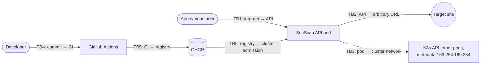

# Threat model

Scope: the SecScan API, its CI/CD pipeline and its Kubernetes deployment, as
of 2026-11-21. Method: STRIDE per trust boundary. Every control names where
it is implemented and **how it is verified**: a test, a CI gate or a check
in `scripts/k8s-verify.sh`. "Review only" means nothing automated checks it.

## System and trust boundaries

| Asset | Why it matters |
|---|---|
| The internal network reachable from the pod (K8s API, other services, cloud metadata) | SSRF turns the scanner into a proxy into it |
| Availability of the API and of the node | anonymous callers make the server do network work |
| The deployed image | whoever controls it runs code in the cluster |
| CI credentials (`GITHUB_TOKEN`, OIDC signing identity) | they can push and sign images |
| Logs and metrics | evidence of abuse, input for alerts |

The API has no users, no accounts and stores no data, so classic
confidentiality threats (auth bypass, data leak) do not apply. The sensitive
thing is **where the server can be made to connect**.

## Threats and controls

Links: [`scanner.py`](../app/scanner.py), [`abuse.py`](../app/abuse.py),
[`main.py`](../app/main.py), [`ci.yml`](../.github/workflows/ci.yml),
[`k8s/`](../k8s), tests in [`tests/`](../tests),
[`k8s-verify.sh`](../scripts/k8s-verify.sh).

### TB1 / TB2: the API and its outbound requests

| # | STRIDE | Threat | Control | Where | Verified by |
|---|---|---|---|---|---|
| A1 | **I** / E | **SSRF**: `/scan?url=` aimed at loopback, private ranges, service names, `169.254.169.254` | resolve, then **allowlist** `is_global` for every address; only http/https on 80/443; no credentials in URL | `scanner.py` `_validate_hop`, `is_public_ip` | `test_ssrf.py`: `test_non_public_addresses_are_rejected`, `test_internal_targets_are_blocked`, `test_non_web_ports_are_blocked`; live before/after in [SSRF.md](SSRF.md) |
| A2 | I | SSRF via **redirect** from a public host to an internal one | `follow_redirects=False`, each `Location` validated again, max 5 hops | `scanner.py` | `test_redirect_to_internal_target_is_blocked`, `test_redirect_chain_is_capped`; live via postman-echo ([ssrf-after.txt](ssrf-after.txt)) |
| A3 | T | **DNS rebinding**: name is public at check time, internal at connect time | connect to the validated IP; original name only in `Host` and TLS SNI | `scanner.py` | `test_dns_rebinding_cannot_reach_loopback`, `test_connection_goes_to_the_validated_ip` |
| A4 | I | Alternate IP encodings (`2130706433`, hex, octal, IPv4-mapped, NAT64, 6to4) | OS resolver + `ipaddress` normalisation, IPv4-mapped unwrapped, NAT64/6to4 refused | `scanner.py` | `test_non_public_addresses_are_rejected`, `test_internal_targets_are_blocked` (parametrised) |
| A5 | I | Error message reveals the internal IP a name resolves to | generic `Blocked target: …` to the caller, reason with IP only in the log | `main.py` | `test_resolved_internal_address_is_logged_but_not_returned` |
| A6 | I / E | **Bug in the SSRF guard** lets a request through anyway | **egress NetworkPolicy**: only kube-dns and TCP 80/443 to public IPs; private, CGNAT, loopback, link-local excluded | `k8s/base/networkpolicy.yaml` | `k8s-verify.sh` §2: raw sockets from the pod to K8s API, demo pod/Service, metadata → BLOCKED, github.com → OPEN; control run without the policy reaches `10.96.0.1:443` |
| A7 | **S** | Client **spoofs `X-Forwarded-For`** to dodge the rate limit | XFF read only if the TCP peer is in `SECSCAN_TRUSTED_PROXIES`; walked right to left; empty by default; in K8s only together with a policy admitting only ingress-nginx | `abuse.py`, `k8s/components/ingress` | `test_forwarded_header_from_an_untrusted_peer_is_ignored`, `test_client_supplied_forwarded_entries_are_ignored`, `test_chain_of_trusted_proxies_is_skipped` |
| A8 | **D** | Request flood; scanner used as a traffic source | per-client rate limit, `429` + `Retry-After`; refused SSRF probes count too | `abuse.py` (slowapi) | `test_scan_over_the_limit_is_rejected_with_429`, `test_blocked_targets_use_up_the_limit_too`; live: 12-request burst → 4× `429` |
| A9 | D | Many slow targets exhaust workers | concurrency cap (`503`, fail fast, no queue); one deadline across all DNS + hops (`504`); slot always released | `abuse.py`, `scanner.py` | `test_scan_is_rejected_when_every_slot_is_busy`, `test_scan_exceeding_the_overall_deadline_returns_504`, `test_deadline_in_dns_releases_the_slot_and_closes_every_response` |
| A10 | D | Huge or endless response body | stream, read headers only, body never read | `scanner.py` | `test_response_body_is_never_downloaded` |
| A11 | T | `HTTP_PROXY`-style variables reroute requests around the pinned IP | `trust_env=False` | `scanner.py` | review only |
| A12 | T | Bad configuration silently weakens a control | every setting parsed at start-up; invalid value stops the process | `config.py` | `test_invalid_value_stops_startup_and_names_the_variable`, `test_defaults_are_safe_when_nothing_is_configured` |
| A13 | **R** | Abuse without a trace | JSON logs for every refusal with URL and reason; counters for 429/503/504/SSRF; Grafana panels | `main.py`, `metrics.py`, `monitoring/` | `test_blocked_target_is_counted_and_logged`, `test_rate_limited_request_is_counted_and_logged`, `test_deadline_is_counted_and_logged`; live screenshot `docs/grafana-abuse.png` |

### TB3: the pod inside the cluster

| # | STRIDE | Threat | Control | Where | Verified by |
|---|---|---|---|---|---|
| K1 | **E** | Container escape / privilege escalation after RCE | PSA `restricted` (enforce, pinned v1.36); non-root uid 10001, `allowPrivilegeEscalation: false`, drop `ALL`, seccomp `RuntimeDefault` | `k8s/namespace`, `k8s/base/deployment.yaml`, `Dockerfile` | API server admits the pod under `restricted`; `k8s-verify.sh` §3 uid 10001 |
| K2 | T | Attacker writes tools or persists in the container | `readOnlyRootFilesystem`; `/tmp` 16 Mi `emptyDir`; no pip/setuptools in the image | `deployment.yaml`, `Dockerfile` | `k8s-verify.sh` §3: write to `/app` fails |
| K3 | I / E | **Stolen ServiceAccount token** used against the K8s API | own SA, `automountServiceAccountToken: false`, no RBAC; API unreachable by egress policy anyway | `k8s/base/serviceaccount.yaml` | `k8s-verify.sh` §3 no token; §2 API blocked |
| K4 | E | **Lateral movement** to other pods/namespaces | default-deny ingress + egress in the namespace | `networkpolicy.yaml` | `k8s-verify.sh` §2 demo pod and Service blocked |
| K5 | D | One pod starves the node; drain takes the service down | requests/limits incl. ephemeral storage; 2 replicas spread by node; PDB `minAvailable: 1`; `maxUnavailable: 0`; startup/readiness/liveness probes | `deployment.yaml`, `pdb.yaml` | rolling update to a new digest without downtime (2026-11-21) |
| K6 | I | Internal topology handed to the process | `enableServiceLinks: false` | `deployment.yaml` | review only |

### TB4–TB6: supply chain

| # | STRIDE | Threat | Control | Where | Verified by |
|---|---|---|---|---|---|
| C1 | **S** / T | Attacker's image (pushed to GHCR, or a **moved tag**) runs in the cluster | Kyverno `NamespacedImageValidatingPolicy`: every image by **digest** and keyless-signed by `ci.yml@refs/heads/main` (issuer GitHub OIDC, Rekor); `failurePolicy: Fail` | `k8s/policy/verify-image-signature.yaml` | `k8s-verify.sh` §4: unsigned → denied, `:latest` without digest → denied |
| C2 | S | Image validly signed via Sigstore, but **by someone else** | exact certificate identity + issuer, not just "has a signature" | Kyverno policy; `cosign verify` in `sbom-sign` | `k8s-verify.sh` §4: `cosign` image signed by Sigstore → denied (SAN mismatch) |
| C3 | T | **Scanned ≠ signed**: a different build gets the signature | build once, push `:<sha>`; Trivy, Syft, Cosign all use that `image@digest`; `:latest` moved only after verify | `ci.yml` | CI logs show one digest in Trivy gate and `REF`; `:latest` = signed digest |
| C4 | T | Vulnerable dependency or OS package shipped | pip-audit (`--strict`, transitive) before build; Trivy on the image, fails on fixable CRITICAL, SARIF in Security tab; Dependabot weekly | `deps`, `build-scan-push` jobs | the gates themselves: pip-audit failed the build on starlette 0.41.3 (16 vulns) until FastAPI was bumped |
| C5 | T | Compromised third-party action or tool image (tag re-pointed) | actions pinned by commit SHA, tool and base images by digest, exact versions | `ci.yml`, `Dockerfile` | Semgrep `p/github-actions`; CI render checks digest pin for k8s |
| C6 | E | A compromised CI step abuses the token (push, sign) | `permissions: {}` by default, per-job minimum; `id-token: write` only in `sbom-sign`; `persist-credentials: false` | `ci.yml` | review only |
| C7 | T | Script injection via `${{ github.* }}` in `run:` | untrusted values passed as `env:`, not interpolated into shell | `ci.yml` | Semgrep `p/github-actions` |
| C8 | I | Secrets committed to the repo | Gitleaks over full history | `secrets` job | CI gate |
| C9 | R | Who built and signed this image? | Rekor transparency log entry; SPDX SBOM attested to the digest | `sbom-sign` | `cosign verify-attestation` in CI |
| C10 | T | Broken or tag-pinned Kubernetes manifests merged | Kustomize render of policy and overlay, image must match `@sha256:<64 hex>` | `test` job | CI gate |

## Accepted risks and known limits

| Item | Risk | Why accepted / mitigation | Revisit |
|---|---|---|---|
| **CVE-2026-85091** zlib1g (HIGH) in `python:3.12-slim` | known HIGH in the base image | fixed in Debian, not yet in the official image; not CRITICAL; digest-pinned builds over ad-hoc `apt upgrade`; `.trivyignore` with `exp:` | **2026-12-10**: merge Dependabot base bump, drop the ignore |
| **DNS oracle** | "blocked" vs "could not resolve" tells a caller whether an internal name exists | useful errors for real users; no IP is returned (A5); rate limit slows probing | if the API becomes public |
| **First resolved IP only** | no fallback if the first record is unreachable | simpler pinning; every record must be public or the request is refused | — |
| **In-memory rate limit** | with N replicas ≈ N × limit; reset on restart | no extra dependency; fix is Redis via slowapi `storage_uri` | before real exposure |
| Per-address limit | users behind one NAT share a bucket; an IPv6 `/64` has many addresses | acceptable for a demo | key IPv6 by `/64` |
| `X-Forwarded-For` trust | anything in the trusted range can claim any client | empty by default; ingress component pairs it with a NetworkPolicy | — |
| DNS lookups cannot be cancelled | a timed-out `getaddrinfo` holds a thread | bounded by the concurrency cap | — |
| `kubectl port-forward` bypasses NetworkPolicy | by design: it enters the pod's netns via the kubelet | control access with RBAC (`pods/portforward`) | — |
| IPv6 egress not covered | policy is IPv4 only | kind cluster is IPv4-only; dual-stack needs `::/0` minus `fc00::/7`, `fe80::/10`, `::1/128` | on dual-stack |
| No SLSA provenance; Kyverno checks the signature, not the SBOM attestation | weaker build-integrity evidence | signature identity already pins workflow + branch | next extension |
| Manual digest pin (`make k8s-pin`) | no GitOps reconciliation or drift detection | digest is in Git, rollback = `git revert` | Argo CD / Flux |
| `failurePolicy: Fail` | Kyverno down → no new pods in `secscan` | fail closed is the safer default; scope is one namespace | — |
| Whoever can push to `main` can get a signed image | CI identity is the root of trust | relies on GitHub account security and branch protection | require reviews |
| Compose Grafana is anonymous **admin** | anyone on the host network can edit dashboards | local demo only, never deployed | — |
| Header grading simplifications | some CSP features not evaluated | documented in [GRADING.md](GRADING.md) | — |
| `starlette.testclient` with `httpx` deprecated | tests may break on a future Starlette | warning only; switch to `httpx2` | next Starlette bump |
